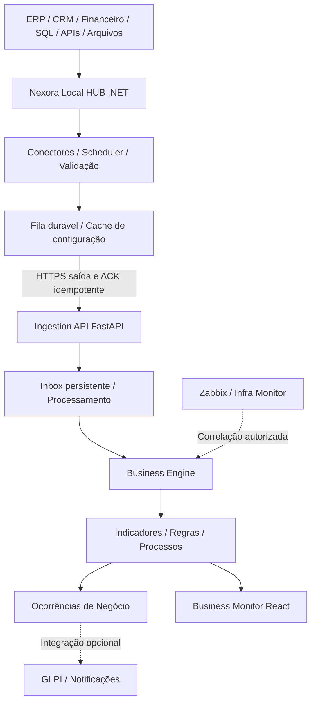

# NEXORA BUSINESS MONITOR — Especificação oficial de produto e desenvolvimento

**Versão:** 1.0  
**Data:** 13/10/2026  
**Status:** Conceito aprovado; implementação e homologação pendentes.  
**Repositório de destino:** `gestormarcosmartins/monitoramento`  
**Caminho oficial previsto:** `docs/NEXORA_BUSINESS_MONITOR_SPECIFICATION.md`

> Este documento complementa `docs/NEXORA_DEVELOPMENT_BLUEPRINT.md`, `docs/NEXORA_DEVELOPMENT_SLICES.md` e `docs/NEXORA_FRONTEND_STANDARD.md`. Segurança, isolamento, GLPI como autoridade ITSM e padrão visual permanecem obrigatórios. Não pressupor funcionalidades já entregues.

## 1. Decisões aprovadas

Nexora é uma plataforma multiempresa com **dois produtos independentes**:

- **Nexora Infrastructure Monitor:** servidores, serviços Windows/Linux, bancos de dados, redes, APIs, aplicações e monitoramento técnico.
- **Nexora Business Monitor:** processos empresariais, indicadores, departamentos, metas, desvios, alertas operacionais e impactos financeiros verificáveis.

Separação obrigatória em menus, painéis, regras, dados, APIs, relatórios, notificações e autorização. Usuários podem ter acesso a nenhum, a um ou a ambos; leitura, criação, edição e administração são permissões distintas por empresa e objeto. Compartilhar autenticação, UI base, FastAPI, PostgreSQL e HUB não confere acesso cruzado. Comercialização independente por módulo é possível. Nexora não substitui ERP ou sistema transacional.

## 2. Arquitetura



A fonte transacional original é autoridade dos dados empresariais. O Nexora armazena indicadores derivados, qualidade, regras, referências mínimas e histórico. GLPI segue autoridade dos chamados ITSM confirmados. Correlação técnica/negócio só revela dados se o usuário tiver permissões de ambos os lados.

## 3. Código existente a aproveitar

| Código/objeto | Diretriz |
|---|---|
| `agent/Nexora.Agent/AgentWorker.cs` | Evoluir como supervisor e despachante de conectores |
| `agent/Nexora.Agent/HostCollector.cs` | Preservar coleta técnica |
| `agent/Nexora.Agent/SqlServerCollector.cs` | Preservar saúde SQL; criar conector de negócio distinto |
| `agent/Nexora.Agent/ChaveouMonitorCollector.cs` | Preservar como integração especializada |
| `agent/Nexora.Agent/CentralClient.cs` | Expandir com configuração versionada, envio business e ACK |
| `agent/Nexora.Agent/LocalQueue.cs` | Evoluir para fila transacional, quotas, replay e integridade |
| `central_monitor/agent_api.py` | Expandir sem quebrar endpoints existentes |
| `cm_agents` e `cm_agent_snapshots` | Reutilizar identidade, heartbeat e inventário |
| `cm_access_grants`, `cm_permission_catalog` | Expandir capacidades e escopos Business |
| `cm_integration_connections`, `cm_integration_inbox` | Reutilizar padrões de conexão, mapeamento e idempotência |
| FastAPI, PostgreSQL, React, Keycloak, Zabbix, GLPI | Preservar, com segregação funcional |

O agente atual é C#/.NET 8 e roda em Windows/Linux; não desenvolver em paralelo um novo agente genérico Python. As rotas e migrações novas usarão o prefixo `cm_`, sem criar um banco lógico paralelo `nx_*`.

## 4. Nexora Local HUB

**Componentes funcionais:**

1. `Hub.Host`: ciclo de vida, heartbeat, saúde, versão e capacidades.
2. `Hub.Connectors.Abstractions`: interface comum para coletores e manifesto de capacidades.
3. `Hub.Connectors.Infrastructure`: coletores atuais preservados.
4. `Hub.Connectors.Business`: SQL Server read-only e REST GET no MVP; PostgreSQL e arquivos na evolução.
5. `Hub.Scheduler`: horários, timeout, concorrência, janelas e circuit breaker.
6. `Hub.Transform`: validação tipada, padronização, minimização e dimensões.
7. `Hub.Queue`: fila persistente, checksum, cota, prioridade, retry e ACK.
8. `Hub.CloudClient`: TLS, identidade do HUB, sincronização de configurações, lotes e confirmações.

**Correções bloqueantes do HUB:** configuração local em cache para continuar coletando sem internet; replay sem perda; correção do caso snapshot gravado mas resultado não completamente processado; IDs estáveis independentes do nome do agente; validação TLS dos bancos; privilégio mínimo (revisar tarefa Windows em SYSTEM); limitação de CPU, memória, consulta e disco; observabilidade de backlog, falha e revisão instalada. Coleta SQL só com credenciais restritas e allowlist de consultas homologadas; validar texto SQL não basta.

O **Hub Studio** deverá permitir selecionar fonte e HUB, testar consulta limitada, mapear atributos, aprovar, publicar revisão e executar rollback com auditoria. Criar indicador não concede direito de editar credenciais nem publicar consulta. A interface visual avançada pode vir após o MVP.

## 5. Módulos do Business Monitor

| ID | Módulo | Escopo |
|---|---|---|
| BM-F01 | Empresas e unidades | Escopo e consolidação apenas de empresas concedidas |
| BM-F02 | Departamentos | Financeiro, Comercial, Produção, Compras, Logística, Atendimento etc. configuráveis |
| BM-F03 | Processos | Etapas, dependências, owner, prazo, calendário e evidência |
| BM-F04 | Indicadores | Tipo, unidade, fonte, meta, dimensões, frequência e histórico |
| BM-F05 | Regras | Limiares, severidade, tolerância, histerese, manutenção e SLA |
| BM-F06 | Ocorrências | Abertura, atribuição, tratamento, normalização, histórico e fechamento humano |
| BM-F07 | Dashboard operacional | Estado por departamento/processo, bloqueios, atrasos e responsáveis |
| BM-F08 | Dashboard executivo | Metas, desvios, tendências e impacto financeiro rastreável |
| BM-F09 | Integrações e coletas | HUB, conexões, versões, qualidade e atrasos |
| BM-F10 | Correlação | Infraestrutura ↔ negócio somente com vínculo e autorização explícitos |
| BM-F11 | Notificações | Rotas e conteúdos restritos por Empresa, área e permissão |
| BM-F12 | Auditoria e exportação | Acesso autorizado, revisão, tempo, fonte, trilhas |

**Estados de indicador:** `normal`, `atencao`, `critico`, `sem_dados`, `suspenso`. Dado ausente/desatualizado nunca aparece verde; `null` nunca vira zero. Exibir última coleta, recebimento, avaliação, fonte, qualidade e versão da regra. Score consolidado não pode mascarar processos críticos. Valor financeiro só se calculado de evidências com moeda, documentos, fórmula e período; diferenciar faturamento represado, exposição estimada, perda confirmada e caixa.

## 6. Segurança e controle de acesso

Autorização deve verificar **identidade + workspace + Empresa concreta + produto + capacidade + escopo do objeto**. O administrador de infraestrutura não tem leitura automática de resultados financeiros; o usuário Business não tem acesso automático a servidores/logs. Master técnico não deve implicar leitura de dados comerciais sensíveis.

| Capability | Ação |
|---|---|
| `business.view` | Ver indicadores/processos/ocorrências concedidos |
| `business.monitor.create` | Criar monitoramentos no escopo permitido |
| `business.monitor.update` | Editar monitoramentos permitidos |
| `business.monitor.inactivate` | Inativar/reativar com auditoria |
| `business.rule.manage` | Administrar regras |
| `business.occurrence.manage` | Acompanhar e agir sobre ocorrências |
| `business.source.view` | Ler metadados sem credenciais |
| `business.source.manage` | Configurar fontes e conexões |
| `business.collector.test` | Executar testes controlados de coleta |
| `business.collector.publish` | Publicar e reverter revisões |
| `business.export` | Exportar somente dados concedidos |
| `business.grants.manage` | Administrar concessões sem autoelevação |

Perfis predefinidos: sem acesso, visualizador, criador, editor, gestor e administrador Business. A concessão é explícita por Empresa/unidade/departamento/processo/objeto, com validade, motivo e concessor. Rotas, menus, API, exports, notificações, agregados, consultas e RLS aplicam o mesmo escopo. `Todas as empresas` é somente leitura e apenas para registros autorizados; mutações exigem Empresa concreta. Testar revogação durante execução assíncrona.

## 7. Banco de dados proposto

Preservar entidades `cm_*` existentes e adicionar, após inventário de sobreposições:

- `cm_business_units`, `cm_business_departments` (reusar departamento existente se aderente);
- `cm_business_processes`, `cm_business_steps`, `cm_business_dependencies`;
- `cm_business_indicators`, `cm_business_indicator_revisions`, `cm_business_indicator_values`, `cm_business_indicator_states`;
- `cm_business_rules`, `cm_business_rule_revisions`, `cm_business_rule_evaluations`;
- `cm_business_occurrences`, `cm_business_occurrence_history`;
- `cm_business_sources`, `cm_business_collectors`, `cm_business_collector_revisions`, `cm_business_collection_runs`;
- `cm_business_access_scopes` somente se os escopos atuais forem insuficientes.

Todas as entidades com tenant_id, FKs compostas que impeçam vínculo entre empresas, RLS forçada, índices por Empresa/indicador/data e retenção governada. Migrations novas e incrementais, sem editar arquivos já aplicados. Credenciais via vault/secret store; não persistir dados brutos, CPF, documentos e salários sem exigência de negócio e controle LGPD.

## 8. Contrato canônico HUB → Business Engine

Exemplo de **estrutura proposta e dados fictícios**:

```json
{
  "schema_version": "1.0",
  "event_id": "evento-exemplo-001",
  "collector_id": "coletor-estavel",
  "indicator_key": "pedidos_pendentes_faturamento",
  "source_id": "erp-local",
  "collected_at": "2026-10-13T08:00:00Z",
  "effective_at": "2026-10-13T08:00:00Z",
  "value_type": "integer",
  "value": 12,
  "unit": "pedidos",
  "dimensions": {"unidade": "unidade-01"},
  "quality": {"status": "valid"},
  "config_revision": 3
}
```

Tenant e HUB derivam da credencial autenticada, não de campos declarados no payload. Reenvio idempotente por ID+hash; duplicado igual retorna resultado, divergente gera conflito. ACK HTTP indica persistência durável, não avaliação concluída. Eventos fora de ordem não regridem estado. Coletas com erros têm status próprio. Para dinheiro usar decimal exato e moeda ISO; não usar floating point.

### APIs novas (propostas, não existentes)

| Endpoint | Responsabilidade |
|---|---|
| `GET /api/v1/business/health` | Consolidado autorizado |
| `GET /api/v1/business/departments` | Departamentos e estados |
| `GET,POST /api/v1/business/processes` | Processos; POST exige criar |
| `GET,POST /api/v1/business/indicators` | Indicadores; POST exige criar |
| `PATCH /api/v1/business/indicators/{id}` | Edição versionada autorizada |
| `GET,POST /api/v1/business/rules` | Regras do escopo |
| `GET /api/v1/business/occurrences` | Ocorrências filtradas |
| `POST /api/v1/business/occurrences/{id}/actions` | Reconhecer, tratar, atribuir |
| `GET /api/v1/business/sources` | Origens/metadados concedidos |
| `POST /api/v1/business/collectors/test` | Teste com quota e auditoria |
| `POST /api/v1/business/collectors/{id}/publish` | Publicação autorizada |
| `POST /api/v1/agent/business-events` | Ingestão autenticada por HUB |

Contratos Pydantic/OpenAPI, erros 401/403/404/409/422/503, paginação, filtros, ordenação, concorrência/versionamento, logs correlacionados e política de autorização antes da entrega.

## 9. Telas e padrão visual

**Ambientes:** manter menu e dashboards técnicos existentes.  
**Negócios:** Visão Geral; Departamentos; Processos; Indicadores e Metas; Monitoramentos; Ocorrências; Relatórios.  
**Integrações & HUB (somente administradores autorizados):** HUB Manager; Conectores; Coletas; Hub Studio; Execuções e Publicações.

Rotas sugeridas: `/negocios/visao-geral`, `/negocios/departamentos`, `/negocios/processos`, `/negocios/indicadores`, `/negocios/monitoramentos`, `/negocios/ocorrencias`. Manter o padrão obrigatório de `NEXORA_FRONTEND_STANDARD.md`: sidebar oficial, identificação da Empresa, cards reais, filtros uniformes, grid em largura integral, paginação, botões com ícones e labels, Novo/Editar sempre em páginas próprias. Mobile 320 px+, foco de teclado e acessibilidade.

## 10. Fluxo ponta a ponta

1. Criador autorizado cadastra processo, indicador e vínculo com Empresa e escopo.
2. Técnico autorizado configura fonte read-only, testa amostra limitada e mapeia campos.
3. Publicador com capability independente aprova a revisão da coleta.
4. HUB recebe configuração validada, coleta dados e mantém fila offline durável.
5. Nexora recebe lote autenticado, grava inbox e confirma armazenamento.
6. Worker deduplica, valida qualidade, persiste série temporal e avalia regra versionada.
7. Desvio cria/atualiza ocorrência própria, notifica somente público autorizado.
8. Retorno normalizado atualiza a saúde, mas não encerra automaticamente chamado GLPI.
9. Correlaciona com infraestrutura apenas quando houver identidade/ligação e autorização comprovadas.

## 11. Segurança operacional

TLS validado, token inicial de uso único, rotação/revogação, conexão do HUB para a nuvem, credenciais em store protegido do SO, não expor SQL local à internet, consultas read-only com tempo/linha/bytes limitados, REST com defesa SSRF, quotas e filas, versões e rollback, coleta offline, alerta de `sem_dados`, auditoria de publicação. Testes adversariais de RLS, exports, notificações e agregados entre duas empresas. Backup e restore com evidência. Nenhum SLA numérico sem homologação. Revisar a visibilidade pública do repositório.

## 12. Roadmap e critérios de aceite

| Corte | Entrega | Dependência | Saída verificável |
|---|---|---|---|
| **BM-00** | Inventário/ADR; matriz reusar-alterar-criar; contratos e escopos | CD-00/CD-02/CD-09 | Plano aprovado sem suposições |
| **BM-01** | HUB confiável (offline, fila, ACK, TLS, idempotência, IDs estáveis) | CD-04/CD-09/CD-10 | Reenvio seguro, offline e sem regressões técnicas |
| **BM-02** | Plugins SQL Server read-only e REST; scheduler/transform | BM-01 | Duas fontes diferentes alimentam indicadores sem fork |
| **BM-03** | Permissões, catálogo Business, RLS e indicadores | BM-00/CD-02 | Independência Infra/Business comprovada |
| **BM-04** | Ingestão, histórico, regras, ocorrências e SLA | BM-01/02/03 | Estado correto com deduplicação e eventos fora de ordem |
| **BM-05** | Menus, dashboards e telas Business | BM-03/04/CD-01 | Telas autorizadas, indicadores reais, mobile homologado |
| **BM-06** | Hub Studio visual e publicação/rollback | BM-02/03/04 | Nova coleta sem recompilar o core |
| **BM-07** | Correlação/impacto verificável/tendências | BM-04/05 | Resultado comprovado e sigilo preservado |

**MVP candidato:** BM-00 a BM-05. BM-06/BM-07 posteriores. IA não integra o MVP; a documentação corrente mantém CD-12 fora de escopo. Piloto com Empresa autorizada e processo real pedido → produção → expedição → faturamento → recebimento, somente após confirmar origem das tabelas/APIs e regras.

### 12.1 Matriz BM-AT

- **BM-AT-01/02:** acesso somente Infra não revela Business e vice-versa.
- **BM-AT-03:** tenant A não acessa ou infere registros, contagens, alertas ou export tenant B.
- **BM-AT-04/05:** criador limitado ao próprio escopo; revogação durante fila bloqueia ação futura.
- **BM-AT-06:** coleta continua sem internet e sobrevive ao reinício; replay quando volta.
- **BM-AT-07/08:** duplicata não gera segundo efeito; falha parcial pós-ingestão é retomada.
- **BM-AT-09/10:** stale/null/fora de ordem/timezone não resultam em verde falso.
- **BM-AT-11:** consulta de escrita, TLS inválido, URL SSRF e segredo em logs bloqueados.
- **BM-AT-12:** métrica financeira exige origem, moeda, fórmula e corte temporal.
- **BM-AT-13:** normalização não fecha ticket humano.
- **BM-AT-14:** responsive e acessibilidade em 320/360/390/768/1024/1366/1920 px.
- **BM-AT-15:** revisão/rollback auditados sem afetar monitoramento técnico.
- **BM-AT-16:** ensaio de carga, fila, indisponibilidade e restore com evidência.

Cada entrega deve registrar migrations, contratos, permissões, testes automatizados, evidência de homologação e rollback. Documentar status de implementação separadamente em `NEXORA_IMPLEMENTATION_STATUS.md`; não marcar como concluído apenas pela presença de código.

## 13. Governança do documento

Este é o **contrato oficial versionado** do Business Monitor. Alterações em conceito, permissões, propriedade dos dados, contrato HUB ou fronteira técnica exigem revisão, justificativa, impacto, nova versão e ADR quando necessário. Cada história deve rastrear BM-F, BM-AT, corte BM e CD existente. Não criar telas fictícias nem regredir monitoramento de ambientes.

| Versão | Data | Registro |
|---|---|---|
| 1.0 | 13/10/2026 | Conceito aprovado, arquitetura modular, HUB .NET, Business Engine, permissões, DB, API, UI, backlog e aceite |
